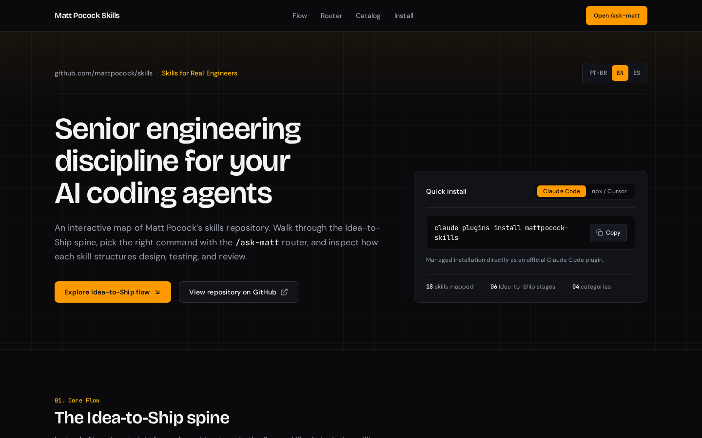
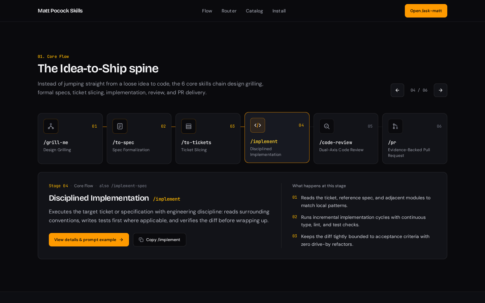
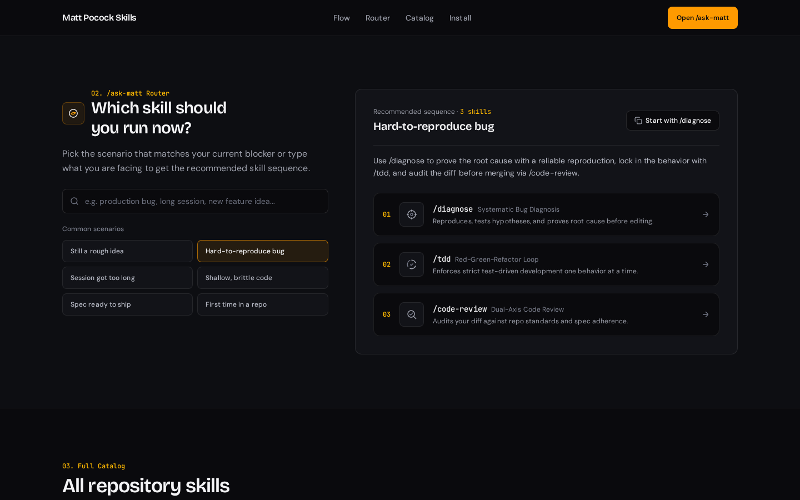
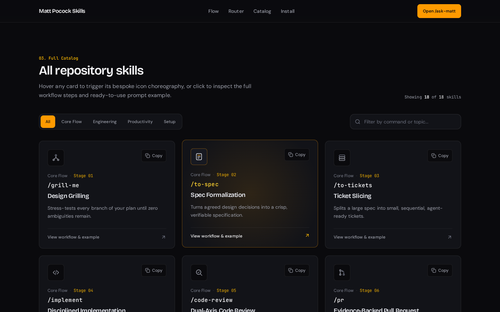
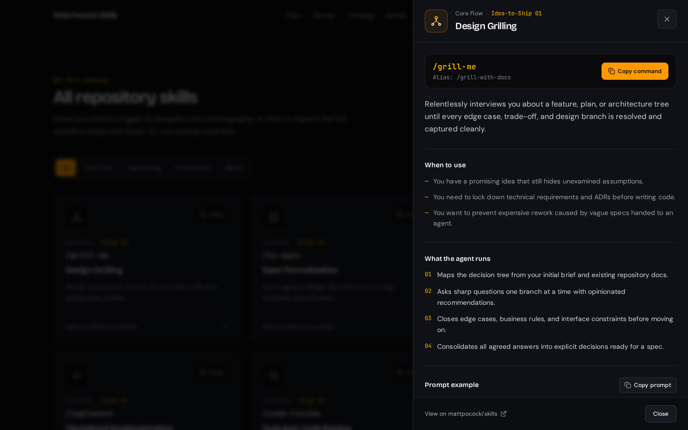

# Matt Pocock Skills — Interactive Showcase

An animated, interactive web showcase for [**mattpocock/skills**](https://github.com/mattpocock/skills) (*Skills for Real Engineers*), built with React, TypeScript, Tailwind CSS, and Framer Motion (`motion/react`).

Explore the **Idea-to-Ship** workflow spine, find the right skill for your current engineering blocker with an interactive `/ask-matt` router, and inspect all 18 skills with bespoke animated vector icons and responsive hover effects.



---

## Interface Walkthrough

### 1. Animated Idea-to-Ship Spine
Interactive 6-stage pipeline (`/grill-me` → `/to-spec` → `/to-tickets` → `/implement` → `/code-review` → `/pr`) with spring-driven progress tracking, shared-element `layoutId` active borders, and live stage previews.



### 2. Interactive `/ask-matt` Scenario Router
Pick a common engineering blocker or type what you are facing in natural language to get the recommended ordered skill track with one-click command copy.



### 3. Filterable Skills Catalog & Hover Choreography
Browse all 18 mapped skills across 4 categories with instant search, pointer-tracking radial hover lighting, and bespoke Framer Motion SVG icon animations on every card.



### 4. Slide-Over Skill Detail Drawer
Click any skill from the pipeline, router, or catalog to inspect when to use it, what the agent executes step by step, copyable slash commands, ready-to-use prompt examples, and connected skills.



---

## Features

- **Animated Idea-to-Ship Spine** — Interactive 6-stage timeline (`/grill-me` → `/to-spec` → `/to-tickets` → `/implement` → `/code-review` → `/pr`) with spring-driven progress tracking, shared-element `layoutId` transitions, and stage previews.
- **Interactive `/ask-matt` Router** — Pick from common engineering scenarios or type your current blocker to immediately get the recommended ordered sequence of skills.
- **18 Bespoke Animated SVG Icons** — Every skill features its own Framer Motion vector choreography triggered on hover, keyboard focus, or selection.
- **Responsive Pointer-Tracking Hover Effects** — Skill cards react smoothly to pointer position with a subtle radial sheen and compositor-only lift animations.
- **Slide-Over Detail Drawer** — Inspect any skill to view when to use it, step-by-step agent behavior, copyable slash commands, ready-to-use prompt examples, and connected skills.
- **Multi-Language Support (`PT-BR` · `EN` · `ES`)** — Instant client-side switching with `localStorage` persistence while keeping original slash commands intact.
- **Accessible by Default** — Keyboard navigation, `focus-visible` states, high-contrast dark editorial typography, and automatic `prefers-reduced-motion` support via `MotionConfig`.

---

## Mapped Skills

| Category | Skills |
| :--- | :--- |
| **Core Flow (Idea-to-Ship)** | `/grill-me`, `/to-spec`, `/to-tickets`, `/implement`, `/code-review`, `/pr` |
| **Engineering & Architecture** | `/tdd`, `/diagnose`, `/improve-codebase-architecture`, `/wayfinder`, `/prototype`, `/triage` |
| **Productivity & Context** | `/handoff`, `/zoom-out`, `/write-a-skill`, `/retro` |
| **Setup & Routing** | `/ask-matt`, `/setup-matt-pocock-skills` |

---

## Tech Stack

- **Framework:** React 19 + TypeScript
- **Build Tool:** Vite 8
- **Styling:** Tailwind CSS v4 (`@tailwindcss/vite`)
- **Animations:** Motion (`motion/react` / Framer Motion)
- **Icons:** Custom animated SVGs + Lucide React
- **Typography:** Bricolage Grotesque, DM Sans, and JetBrains Mono

---

## Getting Started

### Prerequisites

- Node.js 20+
- npm (or Bun)

### Local Development

```bash
# 1. Install dependencies
npm install

# 2. Start the development server (http://localhost:3000)
npm run dev
```

### Available Scripts

| Command | Description |
| :--- | :--- |
| `npm run dev` | Starts the Vite dev server on port `3000`. |
| `npm run build` | Builds the production bundle into `dist/`. |
| `npm run preview` | Previews the production build locally. |
| `npm run lint` | Runs TypeScript type checking (`tsc --noEmit`). |

---

## Installing Matt Pocock's Skills

To use the actual agent skills featured on this page in your own repositories:

**Claude Code (Managed Plugin):**
```bash
claude plugins install mattpocock-skills
```

**Cursor, Copilot & Editable Local Copies (`npx`):**
```bash
npx skills@latest add mattpocock/skills
```

Then run `/setup-matt-pocock-skills` once inside your project to calibrate docs, issue tracking, and triage labels.

---

## Project Structure

```text
docs/
└── screenshots/               # Desktop walkthrough screenshots for README
src/
├── components/
│   ├── AskMattRouter.tsx      # Interactive /ask-matt scenario & query router
│   ├── Header.tsx             # Sticky 3-zone top navigation bar
│   ├── HeroSection.tsx        # Editorial hero, language switcher & quick install
│   ├── IdeaToShipFlow.tsx     # Animated 6-stage Idea-to-Ship pipeline
│   ├── InstallSection.tsx     # CLI installation cards & footer
│   ├── LanguageSwitcher.tsx   # Animated PT-BR / EN / ES segmented control
│   ├── SkillCard.tsx          # Pointer-tracking spotlight hover card
│   ├── SkillCatalog.tsx       # Category tabs & instant search grid
│   ├── SkillDetailDrawer.tsx  # Slide-over inspector with copyable prompts
│   └── SkillIcon.tsx          # 18 custom Framer Motion animated SVG icons
├── data/
│   ├── i18n.ts                # UI copy dictionaries (PT-BR, EN, ES)
│   ├── skills.ts              # Core skills dataset, scenarios & matchers
│   └── skillsTranslations.ts  # Full EN & ES translations for skills & scenarios
├── App.tsx
├── index.css
└── main.tsx
```

---

## Credits & License

- All skill concepts, commands, and workflows are based on Matt Pocock's open-source repository: [github.com/mattpocock/skills](https://github.com/mattpocock/skills).
- This showcase project is licensed under the Apache-2.0 License.
